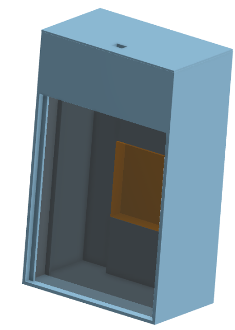
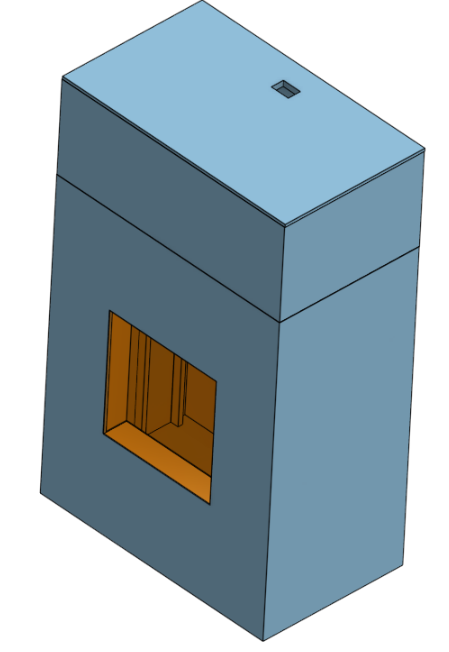

# Charlie's Smart Air Purifier
A smart home compatible air purifier! I am making this project to help with my allergies and to just help make my room a cleaner, more healthy environment!

## Features
- Particulate Matter Sensors
- VOC Sensor
- Temperature Sensor
- Humidity Sensor
- 5 layer HEPA filter
- Home Assistant Controlled
- RPM reporting
- Speed controls

## Rendered Model

## Circuit Diagram

## Components
| Part | Type | Quantity | Unit price (NZD) | Line total (NZD) | Link | Vendor | Funding | Notes |
| :--- | :--- | :---: | ---: | ---: | :--- | :--- | :--- | :--- |
| SEN54-SDN-T | Part | 1 | 65.50 | 65.50 | [DigiKey](https://www.digikey.co.nz/en/products/detail/sensirion-ag/SEN54-SDN-T/15903868?s=N4IgTCBcDaIMoFEByBWALCAugXyA) | Digikey | Grant | Sensor |
| Spector 5-Layer HEPA Filter | Part | 1 | 32.99 | 32.99 | [Bunnings](https://www.bunnings.co.nz/spector-5-layer-hepa-air-purifier-replacement-filter_p0730911) | Bunnings Warehouse | Grant | Filter |
| 6-PIN Wire 1.25mm | Part | 1 | 2.06 | 2.06 | [DigiKey](https://www.digikey.co.nz/en/products/detail/adafruit-industries-llc/5754/21839797?s=N4IgTCBcDaIMoFEByBWALCAugXyA) | Digikey | Grant | Sensor Wire |
| ESP32-WROOM-32 | Part | 1 | 11.74 | 11.74 | [AliExpress](https://www.aliexpress.com/item/1005006469123839.html?spm=a2g0o.productlist.main.2.209e2265ES2NSl&algo_pvid=9e3a7f3c-a644-4a65-98bc-0e3bf60f60ae&algo_exp_id=9e3a7f3c-a644-4a65-98bc-0e3bf60f60ae-1&pdp_ext_f=%7B%22order%22%3A%2219%22%2C%22eval%22%3A%221%22%2C%22fromPage%22%3A%22search%22%7D&pdp_npi=6%40dis%21NZD%2111.74%218.14%21%21%2142.15%2129.20%21%402103292b17949072298025809e10ee%2112000037308610051%21sea%21NZ%217587365770%21X%211%210%21n_tag%3A-29919%3Bd%3Ac30f848a%3Bm03_new_user%3A-29895&curPageLogUid=v2d8uiI8q4iC&utparam-url=scene%3Asearch%7Cquery_from%3A%7Cx_object_id%3A1005006469123839%7C_p_origin_prod%3A) | Aliexpress | Grant | Microcontroller |
| Shipping ESP32 | Shipping | 1 | 10.33 | 10.33 | [AliExpress](https://www.aliexpress.com/item/1005006469123839.html?spm=a2g0o.productlist.main.2.209e2265ES2NSl&algo_pvid=9e3a7f3c-a644-4a65-98bc-0e3bf60f60ae&algo_exp_id=9e3a7f3c-a644-4a65-98bc-0e3bf60f60ae-1&pdp_ext_f=%7B%22order%22%3A%2219%22%2C%22eval%22%3A%221%22%2C%22fromPage%22%3A%22search%22%7D&pdp_npi=6%40dis%21NZD%2111.74%218.14%21%21%2142.15%2129.20%21%402103292b17949072298025809e10ee%2112000037308610051%21sea%21NZ%217587365770%21X%211%210%21n_tag%3A-29919%3Bd%3Ac30f848a%3Bm03_new_user%3A-29895&curPageLogUid=v2d8uiI8q4iC&utparam-url=scene%3Asearch%7Cquery_from%3A%7Cx_object_id%3A1005006469123839%7C_p_origin_prod%3A) | Aliexpress | Grant | |
| Fan AXIAL 119X25MM 12VDC | Part | 1 | 49.35 | 49.35 | [DigiKey](https://www.digikey.co.nz/en/products/detail/nmb-technologies-corporation/11925SA-12R-EUD-1/13252331) | Digikey | Grant | Fan |
| StarTech SVA12M2NEUA | Part | 1 | 36.68 | 36.68 | [PB Tech](https://www.pbtech.co.nz/product/ADPSTT3651588/StarTechcom-SVA12M2NEUA-Replacement-12V-Power-Adap) | PB Tech | Grant | Power |
| OKI-78SR-5/1.5-W36-C | Part | 1 | 13.03 | 13.03 | [DigiKey](https://www.digikey.co.nz/en/products/detail/murata-power-solutions-inc/OKI-78SR-5-1-5-W36-C/2259781) | Digikey | Grant | Voltage Converter |
| 5V Relay | Part | 1 | 10.90 | 10.90 | [Jaycar](https://www.jaycar.co.nz/arduino-compatible-5v-relay/p/XC4419?srsltid=AYCX9vLhqXph1BWmcjVIsQRaiWsmu7q6jFmHFztcdedJEAX5omibkDzV) | Jaycar | Grant | Relay |
| 25YXG220MEFC6.3X11 | Part | 1 | 0.69 | 0.69 | [DigiKey](https://www.digikey.co.nz/en/products/detail/rubycon/25YXG220MEFC6-3X11/3134189?s=N4IgTCBcDa5gDAAgK0DFFgKyIGqIKYA2%2BAxgC4BOA9oQJ5kCWJIAugL5A) | Digikey | Grant | Capacitor |
| 01500260LXN Fuse Holder | Part | 1 | 12.29 | 12.29 | [DigiKey](https://www.digikey.co.nz/en/products/detail/littelfuse-commercial-vehicle-products/01500260LXN/2519241?s=N4IgTCBcDaIDIEsAuSCmAbAZgVwM6oAIAGARgFYiiwA2IuADQDkQBdAXyA) | Digikey | Grant | Fuse Holder |
| 0287002.PXCN Fuse | Part | 5 | 0.79 | 3.95 | [DigiKey](https://www.digikey.co.nz/en/products/detail/littelfuse-inc/0287002-PXCN/3102552?s=N4IgTCBcDaIDIEsAuSCmAbAZgVwM6oAIAGMADgHYiSA6ABQA0BhAORAF0BfIA) | Digikey | Grant | Fuse |
| The Ultimate Heatshrink Pack | Part | 1 | 22.90 | 22.90 | [Jaycar](https://www.jaycar.co.nz/the-ultimate-heatshrink-pack/p/WH5520) | Jaycar | Grant | Heatshrink |
| RA1113112R Switch | Part | 1 | 1.39 | 1.39 | [DigiKey](https://www.digikey.co.nz/en/products/detail/e-switch/RA1113112R/3778055?s=N4IgTCBcDaIM4HcCWAXAxgCxAXQL5A) | Digikey | Grant | Rocker Switch |
| Elegoo PLA Matte filament Matte White 1.75mm 1kg | 3D printed | 1 | 29.90 | 29.90 | [Jaycar](https://www.jaycar.co.nz/elegoo-pla-matte-filament-matte-white-1-75mm-1kg/p/TL6484) | Jaycar | Grant | Filament (I will self-print, print is almost exactly 1kg) |
| **Total** | | | | **303.70** | | | | |
### Note: Gemini was used for converting BOM into this format

## OnShape Files
https://cad.onshape.com/documents/5657ea9d58c4bc3a8dbae36f/w/fcaea32baf2dbbd10a38cf35/e/5e69826395912e37b00f6081
